# Especificação do fluxo de desarquivamento — Arquivo Geral (TJPE)

> **Natureza deste documento.** Descreve o fluxo validado no **protótipo** publicado em https://atendimento.lexcode.tech (versão de 02/11/2026, com as decisões das equipes sobre Q1, Q4, Q6, Q7, Q8 e Q9). O sistema definitivo será desenvolvido pela secretaria responsável. Este texto é a referência funcional para essa equipe: o que o protótipo faz, as regras que ele aplica e o que ainda precisa ser confirmado com as unidades.
>
> O protótipo **não é canal oficial**. Exibe uma faixa de aviso, não é indexado por buscadores e as certidões que gera **não têm validade jurídica**.

## 1. Visão geral

O ciclo começa com o pedido da parte ou do advogado e termina com o processo rearquivado (ou com o registro de que não foi localizado). Três setores participam: **Atendimento**, **Busca e Desarquivamento** e a **Gerência do Arquivo**.

```mermaid
flowchart LR
    P([Parte / advogado]) -->|formulário público| S[solicitado<br/>Aguardando triagem]
    S -->|Atendimento: encaminhar| AB[aguardando_busca]
    S -->|Atendimento: indeferir + motivo| IND([indeferido])
    AB -->|Busca chefe/servidor: atribuir| EB[em_busca]
    EB -->|responsável: localizado| LOC[localizado<br/>a caminho do Atendimento]
    EB -->|responsável: não localizado + motivo| NL[nao_localizado]
    NL -->|Busca ou Atendimento: nova busca| EB
    NL -->|Atendimento: parte avisada| ENC([encerrado])
    LOC -->|Atendimento: confirmou recebimento| DISP[disponivel]
    DISP -->|Atendimento: entregue à parte| CONS[em_consulta]
    CONS -->|Atendimento: parte devolveu| AA[aguardando_arquivamento]
    DISP -.->|parte não compareceu| AA
    AA -->|Busca chefe/servidor: atribuir| EA[em_arquivamento]
    EA -->|responsável: arquivado + local físico| ARQ([arquivado])
```

| Status | Com quem está | Texto mostrado ao público |
|---|---|---|
| `solicitado` | Atendimento | Recebido — em análise pelo Atendimento |
| `indeferido` | — (fim) | Indeferido |
| `aguardando_busca` | Busca | Em busca no Arquivo Geral |
| `em_busca` | Busca (responsável) | Em busca no Arquivo Geral |
| `localizado` | Atendimento | Processo localizado |
| `disponivel` | Atendimento | Disponível para consulta no Atendimento |
| `em_consulta` | Atendimento | Em consulta pela parte |
| `aguardando_arquivamento` | Busca | Devolvido — em rearquivamento |
| `em_arquivamento` | Busca (responsável) | Devolvido — em rearquivamento |
| `nao_localizado` | Atendimento | Processo não localizado |
| `encerrado` | — (fim) | Encerrado — processo não localizado |
| `arquivado` | — (fim) | Concluído — processo rearquivado |

**Nova busca.** Um processo **não localizado** pode voltar a ser procurado, **sem limite de tentativas**, enquanto o pedido não for encerrado. A nova busca pode ser feita pela própria Busca ou **solicitada pelo Atendimento** (por exemplo, quando a parte traz novas informações). Ele volta para `em_busca` com o mesmo responsável (chefe e servidor podem reatribuir); a tentativa anterior e o motivo ficam registrados na linha do tempo. Depois de `encerrado`, não há nova busca: a parte faz um novo pedido.

A tabela de transições existe em um único arquivo (`shared/workflow.js`), usado tanto pelo servidor quanto pela interface. O servidor só aplica uma ação se o pedido estiver na etapa esperada; duas pessoas agindo ao mesmo tempo no mesmo pedido → a segunda recebe aviso de que a etapa mudou.

## 2. Perfis

| Setor | Perfil | Papel |
|---|---|---|
| Gerência | **Gerente do Arquivo** | Cadastra os chefes de unidade (e outros gerentes); pode desativar qualquer usuário; vê todos os pedidos e indicadores. Não executa etapas do fluxo. |
| Atendimento | **Chefe de Unidade** | Tudo o que o servidor faz + cadastra/desativa servidores e operadores do Atendimento. |
| Atendimento | **Servidor** | Opera o fluxo do Atendimento e **emite certidões**. |
| Atendimento | **Operador de Atendimento** | Triagem, recebimento, entrega e devolução; registra observações. |
| Busca | **Chefe de Unidade** | Tudo o que o servidor faz + cadastra/desativa servidores e operadores da Busca. |
| Busca | **Servidor** | Atribui responsáveis e também executa buscas e arquivamentos. |
| Busca | **Operador de Busca e Desarquivamento** | Executa apenas as buscas e arquivamentos **atribuídos a ele**. |

### Matriz de permissões

| Ação | Op. Atend. | Serv. Atend. | Chefe Atend. | Op. Busca | Serv. Busca | Chefe Busca | Gerente |
|---|:-:|:-:|:-:|:-:|:-:|:-:|:-:|
| Ver dados do solicitante (CPF, contato, procuração) | ✔ | ✔ | ✔ | – | – | – | ✔ |
| Encaminhar à Busca / indeferir | ✔ | ✔ | ✔ | – | – | – | – |
| Confirmar recebimento, entregar à parte, registrar devolução, encerrar | ✔ | ✔ | ✔ | – | – | – | – |
| Emitir certidão | – | ✔ | ✔ | – | – | – | – |
| Personalizar modelos de certidão | – | – | ✔ | – | – | – | ✔ |
| Receber alerta de prazo de devolução vencido | – | ✔ | ✔ | – | – | – | – |
| Atribuir responsável (busca ou arquivamento) | – | – | – | – | ✔ | ✔ | – |
| Localizado / não localizado / arquivado | – | – | – | só os seus | ✔ | ✔ | – |
| Nova busca de processo não localizado | ✔ | ✔ | ✔ | só os seus | ✔ | ✔ | – |
| Cadastrar e desativar usuários | – | – | do Atend. | – | – | da Busca | chefes; desativa todos |
| Indicadores | ✔ | ✔ | ✔ | – | ✔ | ✔ | ✔ (com solicitantes) |
| Ver selo de prazo de devolução vencido | ✔ | ✔ | ✔ | – | – | – | ✔ |

Regras complementares:
- **Prazo de devolução (Q7):** o processo tem **1 dia** para voltar ao arquivo, contado de quando fica disponível no Atendimento. Vencido o prazo (situações "disponível" ou "com a parte"), o pedido recebe o selo **"Prazo de devolução vencido"**, entra na aba **"Prazo vencido"** e o **servidor e o chefe do Atendimento** veem um **alerta** no topo da tela. O alerta some quando o processo é enviado para rearquivamento. No protótipo o aviso é só dentro do sistema; o prazo é configurável (`PRAZO_DEVOLUCAO_HORAS`, padrão 24).
- **Segredo de justiça (Q9):** só **advogado habilitado nos autos** ou quem tem **procuração das partes** pode ter acesso ao processo. O formulário exige a OAB (formato UF + número) ou a procuração anexada. Na **triagem**, o Atendimento **classifica** se o processo está em segredo — a declaração do solicitante vem preenchida, mas é o Atendimento quem decide, e uma reclassificação fica registrada. Se for segredo, a **triagem** e a **entrega** exigem marcar a confirmação de habilitação/procuração, também registrada na linha do tempo.
- **Minimização de dados (LGPD):** a Busca nunca recebe CPF, e-mail, WhatsApp, OAB nem a procuração. A Busca também não vê pedidos ainda em triagem ou indeferidos.
- Usuários são **desativados, não excluídos**, para manter o histórico de quem fez o quê. A desativação derruba a sessão imediatamente.
- Ninguém desativa o próprio usuário; é preciso manter ao menos um Gerente ativo.

## 3. Telas

### 3.1 Público
- **Formulário de solicitação** (`/`): dados do solicitante, do processo (NPU com verificação do dígito ou número de tombo), comarca, vara/unidade, segredo de justiça e procuração (PDF/PNG/JPG até 5 MB, conferida pelo conteúdo do arquivo). Ao enviar, mostra o protocolo `AG-000000`.
- **Acompanhar solicitação** (`/consulta`): protocolo + CPF → situação atual e histórico com datas, **sem nomes de servidores nem observações internas**. Limite de 10 consultas a cada 15 minutos por IP.
- **Verificar certidão** (`/verificar/CÓDIGO`): confirma tipo, número, processo, data e servidor emissor.

### 3.2 Atendimento (`/atendimento`)
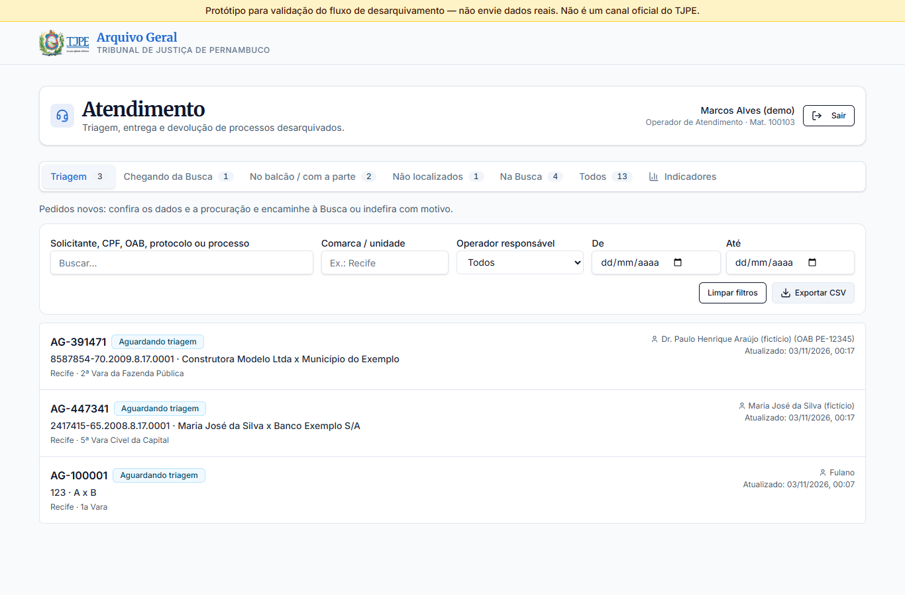

Abas: **Triagem**, **Chegando da Busca**, **No balcão / com a parte**, **Prazo vencido**, **Não localizados**, **Na Busca** (acompanhamento) e **Todos**, cada uma com contador; além de **Modelos de certidão** (edição pelo chefe; consulta pelos demais). Filtros: solicitante (nome, CPF, OAB), protocolo/processo, comarca/unidade, **operador responsável** e período; exportação CSV. Aba **Indicadores** e, para o chefe, **Equipe**.

O detalhe do pedido mostra o **próximo passo** (apenas as ações permitidas ao perfil naquela etapa), dados do processo e do solicitante, responsáveis de cada etapa, certidões, a **linha do tempo** completa (quem fez, quando, com qual nota) e observações internas.

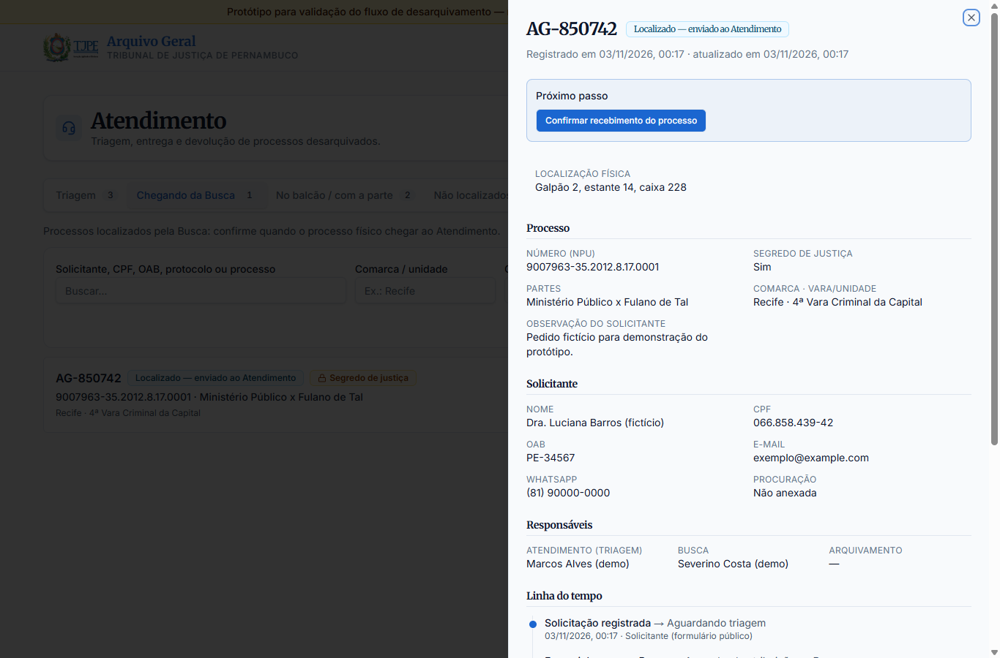
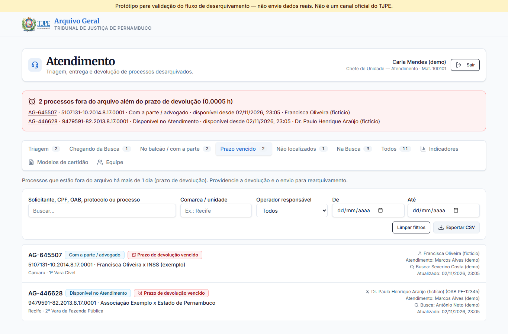
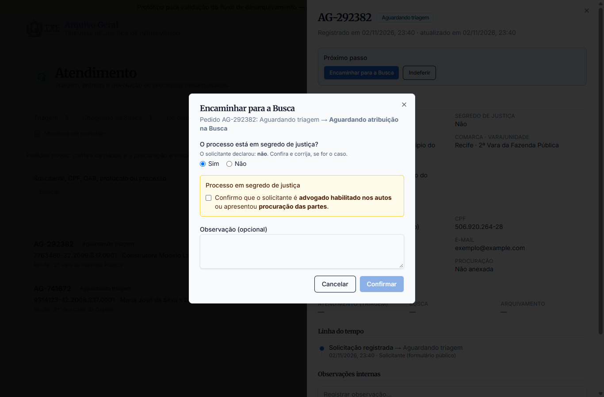
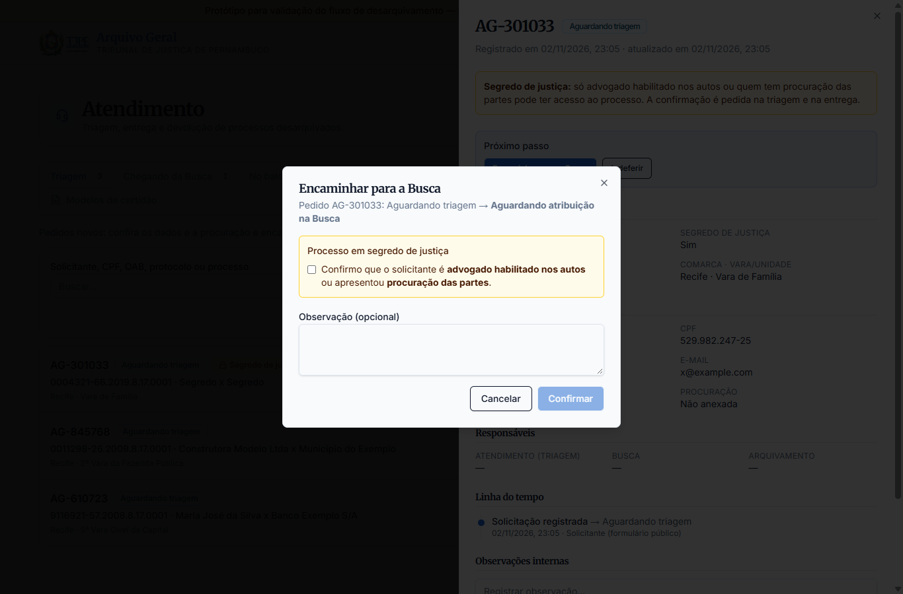

### 3.3 Busca e Desarquivamento (`/busca`)
- **Chefe e servidor:** **A atribuir** (pedidos vindos do Atendimento e processos devolvidos para rearquivar), **Minhas tarefas**, **Em andamento**, **Não localizados** (com a ação "Fazer nova busca") e **Concluídos**.
- **Operador:** **Minhas tarefas** e **Meu histórico**.

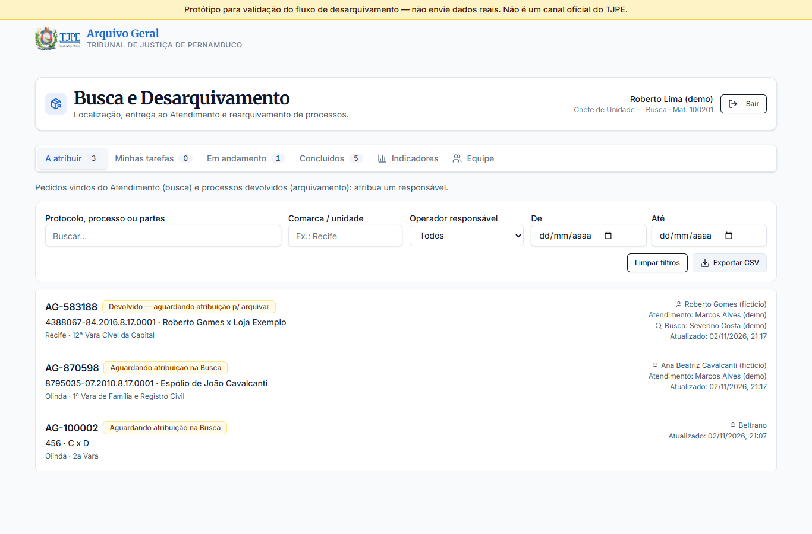
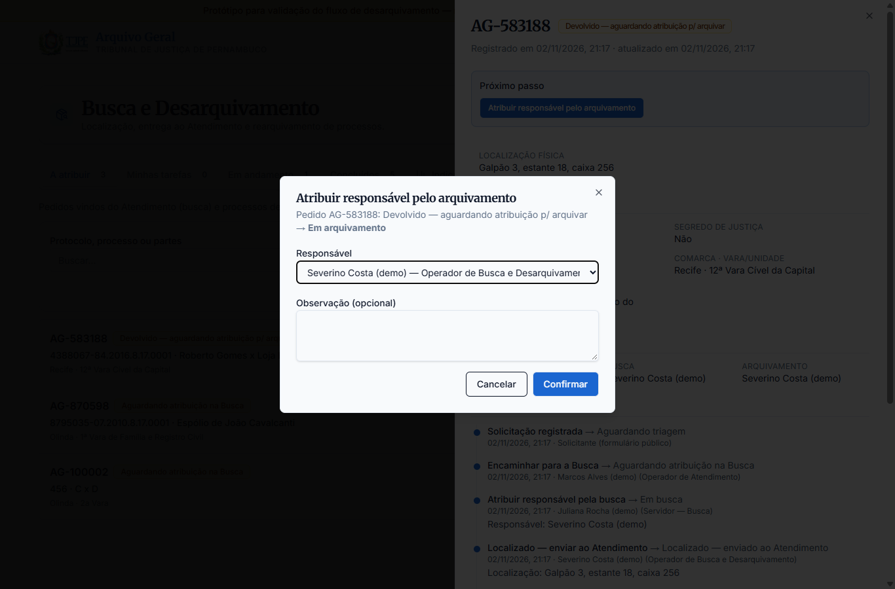
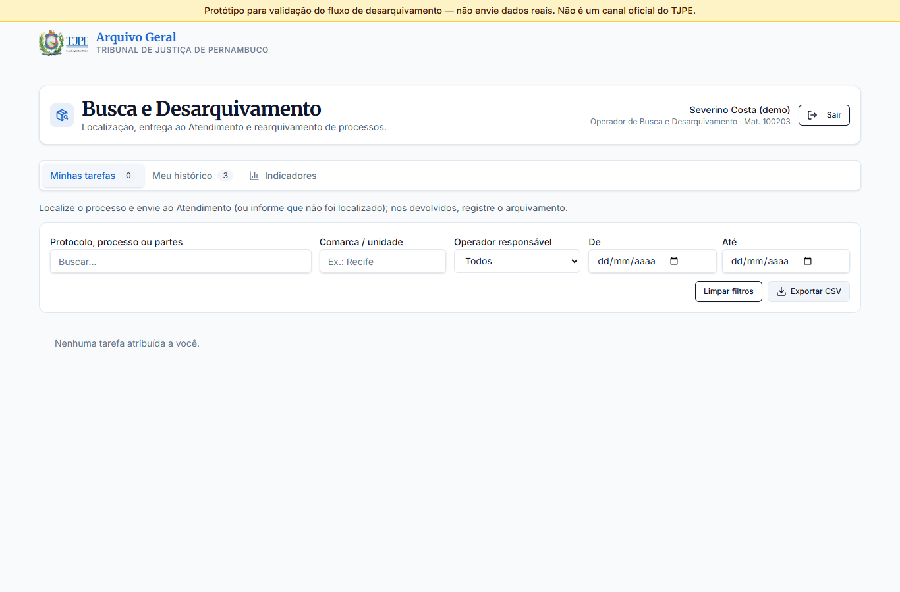
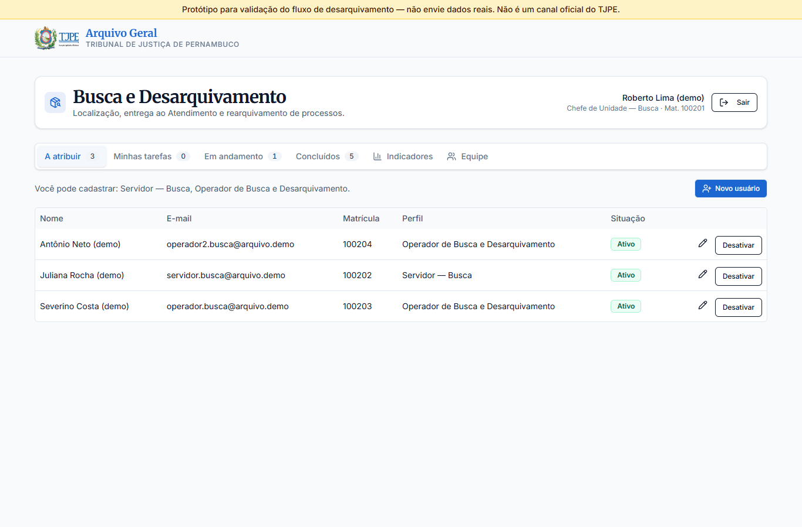

### 3.4 Gerência do Arquivo (`/gerencia`)
Indicadores gerais (total, recebidos hoje, ciclos concluídos, não localizados, ciclo médio em dias, pedidos por situação, **unidades mais solicitadas**, **atuação por operador**, **quem mais solicita**), lista de todos os pedidos e cadastro de usuários.

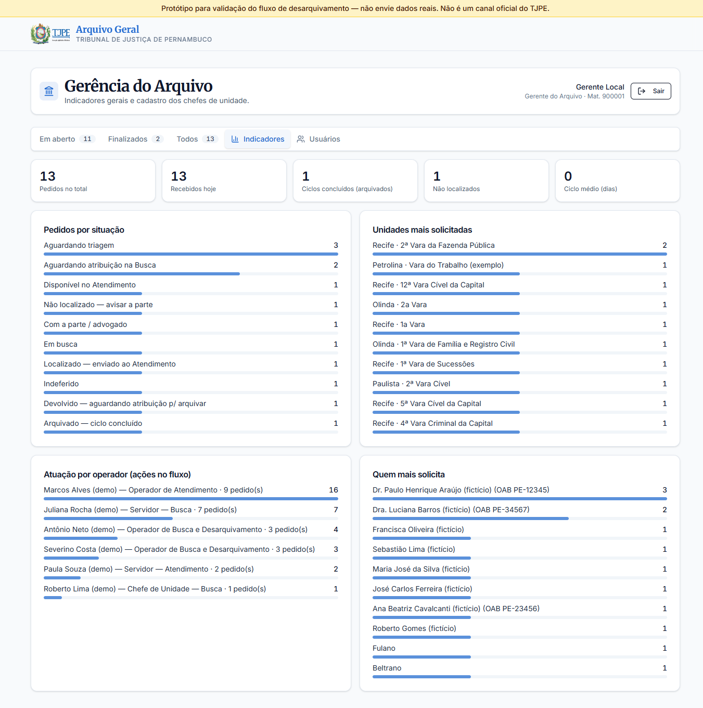

### 3.5 Certidões
Emitidas por servidor ou chefe do Atendimento, a partir de modelos:

| Certidão | Disponível quando o pedido está em |
|---|---|
| Desarquivamento | disponível, em consulta, aguardando/em arquivamento, arquivado |
| Não localização | não localizado, encerrado |
| Arquivamento | arquivado |

**Modelos personalizáveis:** o chefe do Atendimento e o Gerente editam o título e o texto de cada modelo, com campos automáticos (`{processo}`, `{partes}`, `{comarca}`, `{vara}`, `{requerente}`, `{protocolo}`, `{localizacao}`, `{motivo}`), e podem restaurar o padrão. Mudanças valem para as próximas emissões.

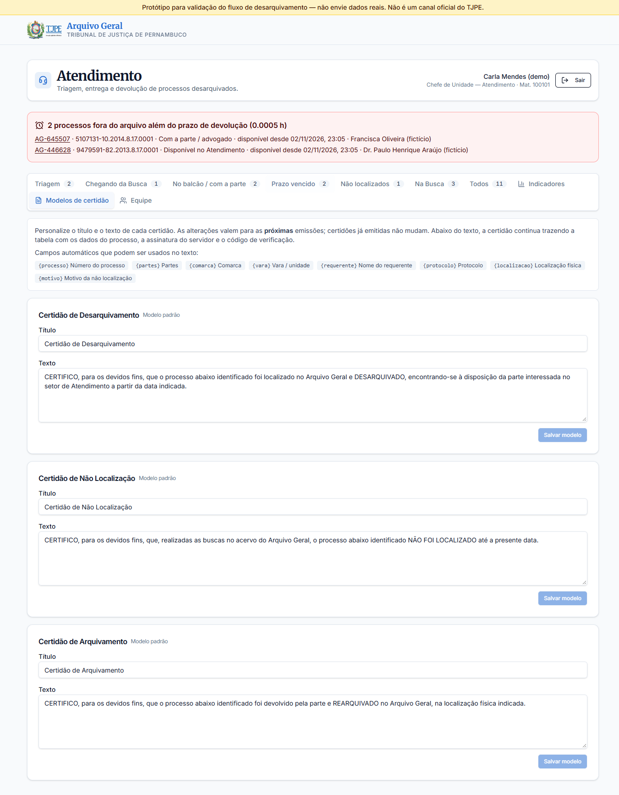

Cada certidão tem número sequencial (`CERT-AAAA-NNNNNN`), código de verificação de 12 caracteres, nome e matrícula do servidor e as datas do fluxo. O conteúdo é congelado no momento da emissão (reimpressões saem iguais). A página abre pronta para imprimir ou salvar em PDF pelo navegador.

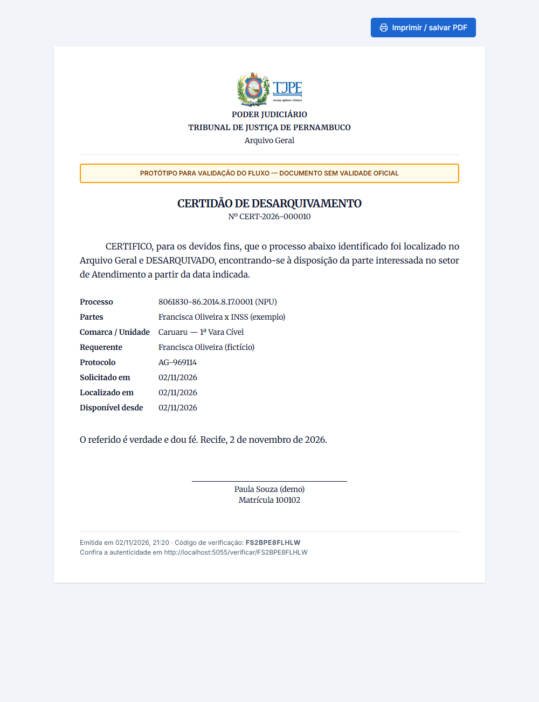
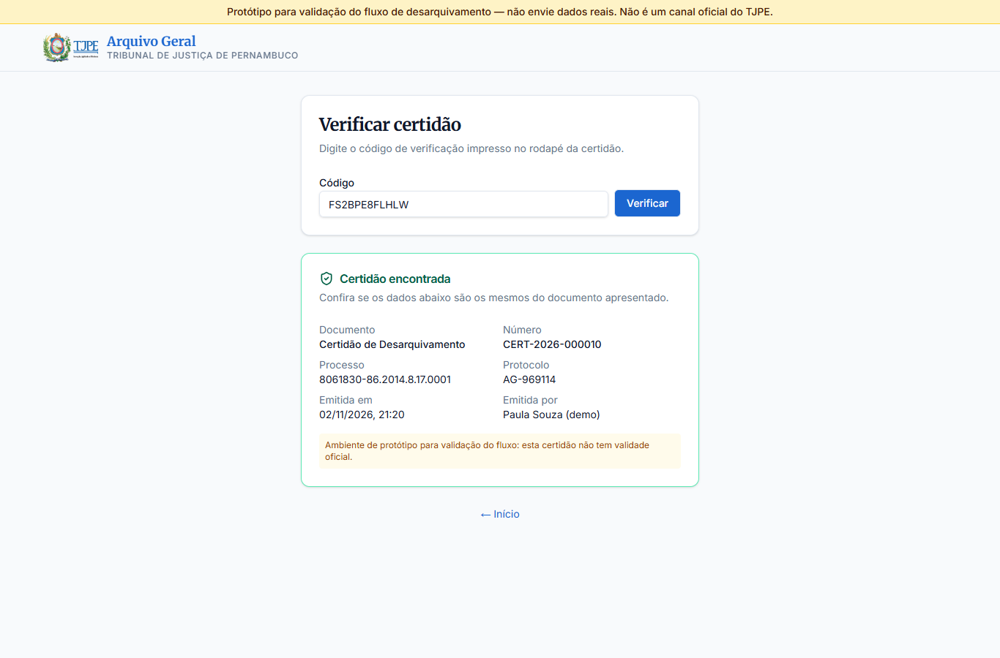

## 4. Dados registrados

- **Pedido:** dados do formulário, situação, responsáveis (triagem, busca, arquivamento), localização física (estante/caixa), motivo (indeferimento / não localização), datas de criação e atualização.
- **Trilha de auditoria** (`request_events`): cada mudança de etapa e cada certidão emitida, com usuário, perfil, data/hora e nota. É a base de "qual operador foi responsável pelo atendimento".
- **Certidões** (`certidoes`): retrato dos dados no momento da emissão.
- **Usuários:** nome, e-mail, matrícula, perfil, ativo/desativado.

## 5. Simplificações do protótipo (a resolver no sistema definitivo)

1. **Certidões sem assinatura** — no sistema oficial, devem ser assinadas (ICP-Brasil ou assinatura eletrônica do Tribunal) e o texto-modelo validado pelo Arquivo/Corregedoria.
2. **Sem notificações** — o protótipo não envia e-mail/WhatsApp à parte; o Atendimento avisa por fora. O sistema definitivo deve notificar a cada mudança relevante (localizado, não localizado, disponível).
3. **Sem integração** com PJe/Judwin/SEI nem com o índice de localização do acervo — a localização física é digitada.
4. **Login próprio** com e-mail e senha — o sistema definitivo deve usar o login institucional (AD/SSO) e, para advogados, eventualmente o certificado/OAB.
5. **Prazos parciais** — só o prazo de devolução (1 dia) tem alerta, e apenas dentro do sistema (sem e-mail). Não há prazos nas demais etapas; o indicador "ciclo médio" é informativo.
6. **Comarca e vara digitadas livremente** — no definitivo, devem vir de tabela oficial de unidades.
7. **Procuração guardada no banco** (até 5 MB) — no definitivo, usar repositório de documentos com retenção definida (LGPD).

## 6. Questões para validar com as equipes

| # | Pergunta | Como o protótipo faz hoje |
|---|---|---|
| Q1 | O Atendimento faz triagem (confere procuração/segredo) antes de enviar à Busca? | **Confirmado:** sim; pode indeferir com motivo obrigatório. |
| Q2 | Quem atribui o responsável pela busca? O operador pode "pegar" um pedido sozinho? | Chefe ou servidor da Busca atribuem; operador não se autoatribui. |
| Q3 | No rearquivamento, deve ser a mesma pessoa que fez a busca? | Sugere a mesma pessoa; chefe/servidor podem trocar. |
| Q4 | Operadores do Atendimento devem poder emitir certidão? | **Confirmado:** não; só servidor e chefe. |
| Q5 | O Gerente deve poder executar etapas do fluxo (substituição)? | Não; só acompanha e administra usuários. |
| Q6 | Quando o processo não é localizado, há nova tentativa de busca? | **Definido (02/11/2026):** sim, sem limite de tentativas; a Busca pode fazer e o Atendimento pode solicitar nova busca, até o pedido ser encerrado. |
| Q7 | Se a parte não comparece, qual o prazo para devolver o processo ao arquivo? | **Definido:** 1 dia; vencido, alerta para o servidor e o chefe do Atendimento. *A validar:* dia corrido (24 h, como no protótipo) ou dia útil; alerta também por e-mail. |
| Q8 | O texto das três certidões está adequado? Faltam tipos (ex.: certidão narrativa)? | **Definido:** os modelos devem ser personalizáveis (feito: chefe do Atendimento e Gerente editam). *A validar:* se é preciso criar novos tipos de certidão além dos três. |
| Q9 | Processos em segredo de justiça exigem regra extra (ex.: só advogado habilitado)? | **Definido:** só advogado habilitado ou com procuração das partes. Formulário exige OAB ou procuração; o Atendimento classifica o segredo na triagem; triagem e entrega exigem confirmação. |
| Q10 | Quais indicadores a Gerência precisa acompanhar periodicamente? | Os listados em 3.4. |

## 7. Segurança (protótipo)

Revisões feitas com o método ECC (`security-reviewer` + `code-reviewer`), a última em 02/11/2026, sem achados críticos ou altos em aberto. Pontos que o sistema definitivo deve manter:
- Autorização sempre no servidor, por perfil e por etapa (a interface só esconde botões); escopo de dados por perfil (a Busca não recebe dados pessoais do solicitante).
- Segredo de justiça classificado por servidor, não apenas pela declaração do solicitante.
- Sessão regenerada no login, cookie `HttpOnly`/`Secure`/`SameSite=Strict`, usuário recarregado do banco a cada requisição (desativação e troca de senha valem na hora), limite de tentativas de login e nos formulários públicos.
- Validação de todas as entradas no servidor (zod 4), SQL parametrizado, tipo real do anexo conferido pelo conteúdo, exportação CSV protegida contra fórmulas, CSP restritiva para scripts.
- Dependências de produção sem vulnerabilidades conhecidas (`npm audit --omit=dev`).

## 8. Referências técnicas do protótipo

- Regras do fluxo e permissões: `shared/workflow.js` (1.079 testes automatizados de regras e validações em `tests/`).
- API: `server/routes.js` (rotas e escopo por perfil) e `server/storage.js` (SQL, transações e trilha).
- Teste de ponta a ponta da API em `tests/e2e/` (cerca de 105 verificações — 107 com prazo curto de teste, 106 com o prazo real: ciclo completo, prazo de devolução e alertas, segredo de justiça, modelos de certidão, não localização com novas buscas, indeferimento, permissões negadas, concorrência, consulta pública, gestão de usuários) e regressão da auditoria (31 verificações).
